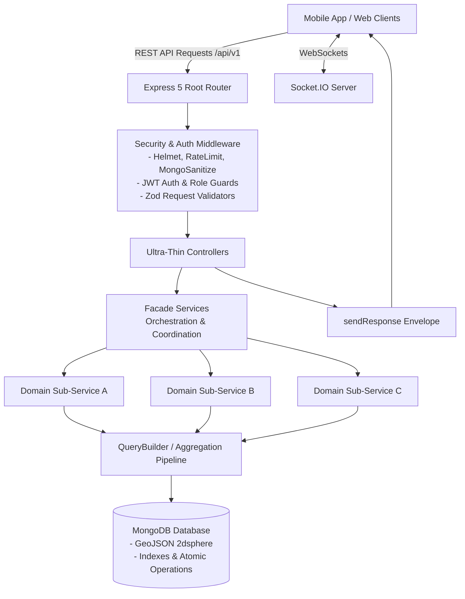

# GoSNKR — Hyper-Local Sneaker & Streetwear Backend

[](https://nodejs.org/)
[](https://www.typescriptlang.org/)
[](https://expressjs.com/)
[](https://mongoosejs.com/)
[](LICENSE)
[-brightgreen.svg)]()

> High-performance, modular monolith backend powering **GoSNKR** — a hyper-local multi-vendor sneaker and streetwear commerce ecosystem connecting **Buyers (Customers)**, **Retailers (Local Stores)**, and **Resellers (Secondary Market & B2B Traders)**.

---

## 📖 Table of Contents
- [Project Overview](#-project-overview)
- [Key Features & User Roles](#-key-features--user-roles)
- [23 Functional Modules](#-23-functional-modules)
- [System Architecture & Design Patterns](#-system-architecture--design-patterns)
- [Technology Stack](#-technology-stack)
- [Directory Structure](#-directory-structure)
- [Getting Started](#-getting-started)
- [Environment Configuration](#-environment-configuration)
- [API Documentation & Specification](#-api-documentation--specification)
- [Real-Time WebSocket Engine (Socket.IO)](#-real-time-websocket-engine-socketio)
- [Security & Production Readiness](#-security--production-readiness)
- [Development Guidelines](#-development-guidelines)

---

## 🚀 Project Overview

**GoSNKR** solves high fragmentation and sizing uncertainty in the sneaker and streetwear market. Rather than relying solely on slow centralized shipping hubs, GoSNKR unites local brick-and-mortar boutique inventory with verified secondary market resellers and end customers through **instant size-based live discovery**, **geospatial store scanning**, **deposit-backed holds**, **in-store pickups**, and **B2B negotiations**.

### Core Value Propositions
* **Size-First Discovery:** Automatic filtering matching the user's saved shoe and apparel sizes across all local inventory.
* **Hyper-Local Geospatial Engine:** MongoDB GeoJSON 2dsphere indexing calculating exact distances (miles) to physical store shelves.
* **4-Stage Order Lifecycle:** Seamless retailer dispatch workflow (`Needs Action` ➔ `Holds` ➔ `Ready` ➔ `History`).
* **Deposit-Backed Holds:** Secure in-store reservations with configurable time-to-live (TTL) expiration.
* **Dual Resale Dynamics:** C2B (Sell-to-Store cashouts) and B2B (Reseller-to-Store batch negotiations with counter-offers).
* **High-Speed Aggregation Pipelines:** Strictly zero N+1 queries by replacing Mongoose `.populate()` with native MongoDB `$lookup` sub-pipelines.

---

## 👥 Key Features & User Roles

| Role | Core Capabilities | Primary Workflows |
|---|---|---|
| **Buyer (Customer)** | Size profiling, geo-discovery, checkout, deposit holds, store following, C2B sell-to-store | Saves sizes ➔ scans nearby stores ➔ places deposit hold or buys for pickup/shipping ➔ earns VIP points. |
| **Retailer (Store)** | Multi-branch inventory sync, 4-stage order fulfillment, flash sale promotions, store analytics | Manages catalog & sizes ➔ processes incoming holds & orders ➔ launches targeted geo-promotions ➔ buys inventory from users. |
| **Reseller (Trader)** | Consignment/deadstock listings, negotiation engine, counter-offers, visibility controls | Lists sneakers/apparel ➔ receives store offers ➔ negotiates price in real-time ➔ finalizes verified deals. |
| **Admin (Operator)** | Store verification, KYC approvals, commission tracking, dispute resolution, platform governance | Approves retailers/resellers ➔ audits financial transactions ➔ manages dispute mediation. |

---

## 📦 23 Functional Modules

The backend implements the 23 functional modules mapped to the mobile UI application:

1. **Authentication & User System:** Multi-role JWT authentication (Buyer, Retailer, Reseller, Admin), OTP verification, password hashing via bcrypt, and profile management.
2. **Sneaker Search & Discovery:** Multi-attribute full-text search, SKU/style-code lookups, size matching, and trending searches.
3. **Size-Based Live Shopping:** Real-time stock availability filtered by user sizing preference with physical distance calculations.
4. **Filters & Sorting:** Granular filters for brand, model, size, distance radius (5–50+ miles), condition, and price ranges.
5. **Hold / Reservation System:** Deposit-backed holds with automated countdown timers and atomic inventory reservations.
6. **In-Store Pickup & Delivery:** Order collection workflows with QR/code verification, prep-time tracking, and courier delivery options.
7. **Real-Time Inventory & Multi-Branch:** Multi-location stock allocation, SKU tracking, size variant quantity management, and sync.
8. **Promotion Engine:** Targeted geo-promotions (Flash Sales, Exclusive Drops) segmented by followers, location, and size matches.
9. **Cart & Multi-Store Checkout:** Multi-retailer split orders, automated tax & shipping calculations, and Stripe payment processing.
10. **C2B Sell-to-Store:** Customer-to-store sneaker cashout requests with condition appraisal and payout offers.
11. **Retailer Order & Store Operations:** Real-time order management dashboard across 4 fulfillment stages (`Needs Action`, `Holds`, `Ready`, `History`).
12. **Store Profile, Followers & Reviews:** Store branding, operational hours, verified customer reviews, and follow-for-restock alerts.
13. **Reseller Marketplace & B2B Sourcing:** Peer-to-store marketplace, counter-offer negotiations, and deal confirmation timelines.
14. **Push Notifications & Alerts:** Real-time push and in-app action alerts (`Accept`, `Counter`, `Decline`) for orders, holds, and price updates.
15. **Real-Time Chat & Negotiation:** WebSocket-based direct messaging between buyers, retailers, and resellers with image attachment support.
16. **User Engagement & Social Layer:** Store restock alerts, wanted lists, wishlist restock pings, and activity feeds.
17. **Locker / Box Collection:** Secure automated locker integration for off-hours order collection.
18. **Trust, Verification & Authentication:** Multi-tier authentication checklists, reseller trust score badges, and condition ratings.
19. **VIP & Loyalty Program:** 4-tier customer rewards program (Bronze, Silver, Gold, Platinum) with exclusive access perks.
20. **Analytics & Performance Dashboard:** Real-time revenue metrics, average prep times, conversion rates, and inventory velocity.
21. **Support & Dispute Resolution:** Multi-channel ticket management, reason codes, order attachments, and escalation paths.
22. **Admin Operations & Platform Governance:** KYC compliance, store on-boarding approval, commission fee management, and user moderation.
23. **Settings & Visibility Controls:** Granular privacy toggles (Public Profile, Show Listings, Show Prices, Hide Location, Online Status).

---

## 🏛 System Architecture & Design Patterns



### 1. Ultra-Thin Controllers & Facade Pattern
* **File Length Discipline:** Monolithic, giant files are strictly avoided. Service files exceeding ~200–250 lines are decomposed into focused **sub-services** (Single Responsibility Principle).
* **Facade Service:** Coordinates complex transactional flows across sub-services (e.g., checkout pricing, inventory lock, payment execution, and push dispatch), providing a clean, single point of interaction for the controller.

### 2. High-Performance Aggregation (Strictly No `.populate()`)
* Mongoose `.populate()` is banned across the codebase to prevent sequential N+1 database round-trips.
* Native MongoDB Aggregation (`Model.aggregate([...])`) is employed with `$lookup` sub-pipelines (`let` + `pipeline`), indexed `$match`, field-trimming `$project`, and parallelized `$facet` for ultra-fast, single-trip database queries.

### 3. Centralized QueryBuilder
All catalog, feed, and search endpoints use [`src/app/builder/QueryBuilder.ts`](file:///r:/STA/sonnysgr_backend/src/app/builder/QueryBuilder.ts):
```typescript
const queryBuilder = new QueryBuilder(Product.find(filterCondition), req.query)
  .search(['name', 'brand', 'category', 'sku'])
  .filter()
  .sort()
  .paginate()
  .fields();

const result = await queryBuilder.modelQuery;
const meta = await queryBuilder.countTotal();
```

### 4. Standardized API Response Envelope
Every endpoint returns a consistent JSON contract via `sendResponse`:
```json
{
  "statusCode": 200,
  "success": true,
  "message": "Operation successful",
  "meta": {
    "page": 1,
    "limit": 10,
    "total": 100,
    "totalPage": 10
  },
  "data": {}
}
```

### 5. Robust Global Error Handling
The central `globalErrorHandler` catches and normalizes:
* **Zod Validation Errors** (with path-specific validation messages)
* **Mongoose Validation & Cast Errors**
* **MongoDB Duplicate Key Errors** (`11000`)
* **Custom AppError / ApiError** with HTTP status codes

---

## 🛠 Technology Stack

| Layer | Technologies |
|---|---|
| **Runtime & Language** | Node.js (LTS), TypeScript 5.9 (Strict Mode, ES2022) |
| **Web Framework** | Express 5.1 |
| **Database & ODM** | MongoDB, Mongoose 8.19 (GeoJSON 2dsphere indexing, Transactions) |
| **Validation** | Zod 4.1 |
| **Authentication & Security** | JWT (Bearer tokens), bcrypt (12 salt rounds), Helmet 8, Mongo-Sanitize, Express-Rate-Limit |
| **Real-Time Communication** | Socket.IO 4.8 |
| **Payment Gateway** | Stripe SDK (Intent checkout & Webhook processing) |
| **File Storage** | Multer local storage / AWS S3 SDK (`@aws-sdk/client-s3`) |
| **Email Transporter** | Nodemailer with SMTP templates |
| **API Documentation** | Redocly OpenAPI 3.1 |
| **Logging** | Winston & Daily Rotating File Transport |

---

## 📁 Directory Structure

```text
sonnysgr_backend/
├── src/
│   ├── app.ts                          # Express application setup, middlewares, global handlers
│   ├── server.ts                       # Server startup, MongoDB connection, Socket.IO setup
│   └── app/
│       ├── builder/
│       │   └── QueryBuilder.ts         # Centralized search, filter, sort, paginate builder
│       ├── config/
│       │   └── index.ts                # Strongly typed environment configuration
│       ├── DB/
│       │   └── index.ts                # Database bootstrap & admin superuser seeding
│       ├── docs/
│       │   ├── openapi.json            # OpenAPI 3.1 specification
│       │   └── docs.routes.ts          # Interactive Redocly API documentation route
│       ├── errors/                     # AppError, Zod, Cast, and Duplicate error formatters
│       ├── interface/                  # Global TypeScript contracts
│       ├── middleware/                 # auth, validateRequest, rateLimiter, multer, errorHandler
│       ├── modules/                    # Feature modules (Controller, Service, Model, Routes, Validation)
│       │   ├── auth/
│       │   ├── Buyer/
│       │   ├── Retailer/
│       │   ├── Reseller/
│       │   ├── Product/
│       │   ├── Order/
│       │   ├── OrderPayment/
│       │   ├── Cart/
│       │   ├── Promotion/
│       │   ├── Pairs/                  # Reseller secondary marketplace & negotiations
│       │   ├── Demand/                 # Sourcing requests
│       │   ├── Chat/                   # Real-time negotiation conversations
│       │   ├── Notification/
│       │   ├── ReviewManagement/
│       │   ├── Settings/
│       │   ├── Support/
│       │   ├── Dashboard/              # Admin governance & analytics
│       │   └── ...
│       ├── routes/
│       │   └── index.ts                # Centralized /api/v1 router aggregation
│       └── utils/
│           ├── catchAsync.ts           # Asynchronous controller error wrapper
│           └── sendResponse.ts         # Standardized JSON response envelope
├── AGENTS.md                           # AI Agent & Engineering Persona Guidelines
├── .env.example                        # Template environment variables
├── package.json                        # Scripts and dependencies
└── tsconfig.json                       # Strict TypeScript configuration
```

---

## 🏁 Getting Started

### Prerequisites
* **Node.js**: `v20.x` or higher (LTS recommended)
* **npm**: `v10.x` or higher
* **MongoDB**: Atlas cluster or local replica set (transactions require replica sets)

### Installation
1. Clone the repository:
   ```bash
   git clone <repository-url>
   cd sonnysgr_backend
   ```
2. Install dependencies:
   ```bash
   npm install
   ```
3. Set up environment variables:
   ```bash
   cp .env.example .env
   # Edit .env with your MongoDB, JWT, and SMTP credentials
   ```
4. Run in development mode:
   ```bash
   npm run dev
   ```
5. Verify TypeScript compilation:
   ```bash
   npx tsc --noEmit
   ```
6. Build for production:
   ```bash
   npm run build
   npm start
   ```

---

## ⚙️ Environment Configuration

Create a `.env` file in the root directory:

```dotenv
# Application
NODE_ENV=development
PORT=5000
BASE_URL=http://localhost:5000

# Database
DATABASE_URL=mongodb+srv://<username>:<password>@cluster.mongodb.net/gosnkr?retryWrites=true&w=majority

# Security & Hashing
BCRYPT_SALT_ROUNDS=12
JWT_SECRET=super_secret_jwt_access_key
JWT_EXPIRES_IN=7d
JWT_REFRESH_SECRET=super_secret_jwt_refresh_key
JWT_REFRESH_EXPIRES_IN=30d

# Email / SMTP
SMTP_HOST=smtp.gmail.com
SMTP_PORT=587
SMTP_SERVICE=gmail
SMTP_MAIL=notifications@gosnkr.com
SMTP_PASSWORD=app_generated_password
SERVICE_NAME=GoSNKR

# Stripe Payments
STRIPE_SECRET_KEY=sk_test_...
STRIPE_WEBHOOK_SECRET=whsec_...

# AWS S3 Storage (Optional)
AWS_REGION=us-east-1
AWS_ACCESS_KEY_ID=AKIA...
AWS_SECRET_ACCESS_KEY=...
AWS_BUCKET_NAME=gosnkr-assets
```

---

## 📚 API Documentation & Specification

The backend includes interactive **Redocly OpenAPI 3.1** documentation:
* **Interactive UI:** Navigate to `http://localhost:5000/docs` or `http://localhost:5000/api/v1/docs`
* **Raw OpenAPI JSON:** `http://localhost:5000/docs/openapi.json`
* **Root Health Check:** `GET /` returns server status

### Core Route Prefixes (`/api/v1`)
* `/api/v1/auth` — Registration, OTP verification, login, password management
* `/api/v1/buyer` — Sizing preferences, followed stores, wishlist, location updates
* `/api/v1/retailer` — Store profiles, multi-branch management, inventory stock, order stages
* `/api/v1/reseller` — Listing creation, offer reviews, dashboard metrics, visibility controls
* `/api/v1/product` — Product catalog, barcode/SKU search, size-based live feeds
* `/api/v1/cart` — Add to cart, variant selection, checkout preparation
* `/api/v1/order` — Order status transitions, pickup codes, delivery tracking
* `/api/v1/order-payment` — Stripe checkout session creation & webhook listener
* `/api/v1/pairs` — Reseller B2B negotiation, counter-offer history, deal confirmation
* `/api/v1/promotion` — Retailer flash sales, audience targeting, promotional banners
* `/api/v1/chat` — Direct messaging history, conversation threads
* `/api/v1/notifications` — In-app alerts, offer action buttons (`Accept`, `Counter`, `Decline`)
* `/api/v1/dashboard` — Admin analytics, KYC store verification, user management

---

## ⚡ Real-Time WebSocket Engine (Socket.IO)

The real-time layer operates over Socket.IO on the same HTTP port:
* **Authentication:** Clients provide Bearer JWT during handshake (`handshake.auth.token`).
* **Room Architecture:** Each user joins their private room: `socket.join(profileId)`.
* **Primary Events:**
  * `send_message`: Emits messages to destination conversation participants.
  * `get_chat_list`: Fetches conversation list with unread counts.
  * `get_messages`: Loads paginated message history.
  * `send_conversation_request`: Initiates negotiation between store and reseller.

---

## 🛡 Security & Production Readiness

* **Zero TypeScript Compilation Errors:** Continuous verification with `npx tsc --noEmit`.
* **HTTP Security Headers:** Protected by `helmet`.
* **Rate Limiting:** Managed by `express-rate-limit` against brute-force and DDoS attempts.
* **NoSQL Injection Prevention:** Enforced via `mongo-sanitize`.
* **Password Hashing:** Passwords encrypted with `bcrypt` (12 salt rounds).
* **Idempotent Webhooks:** Stripe webhook listener validates raw signatures before processing payments.
* **Safe Production Errors:** Stack traces are suppressed in production environments.

---

## 📜 Development Guidelines

All developers and AI assistants working on this repository must strictly adhere to [`AGENTS.md`](file:///r:/STA/sonnysgr_backend/AGENTS.md):
1. **Explain First:** Outline proposed file changes and architectural impact before writing code.
2. **Strict Scope:** Implement only the documented 23 modules; no unrequested or speculative features.
3. **Always QueryBuilder:** Use `QueryBuilder` for all list/search/pagination endpoints.
4. **Aggregation First:** Never use `.populate()`; use single-trip native aggregation pipelines.
5. **Facade Pattern:** Break down services over 250 lines into modular sub-services.
6. **Verify Always:** Confirm `npx tsc --noEmit` exits with 0 errors before concluding changes.
